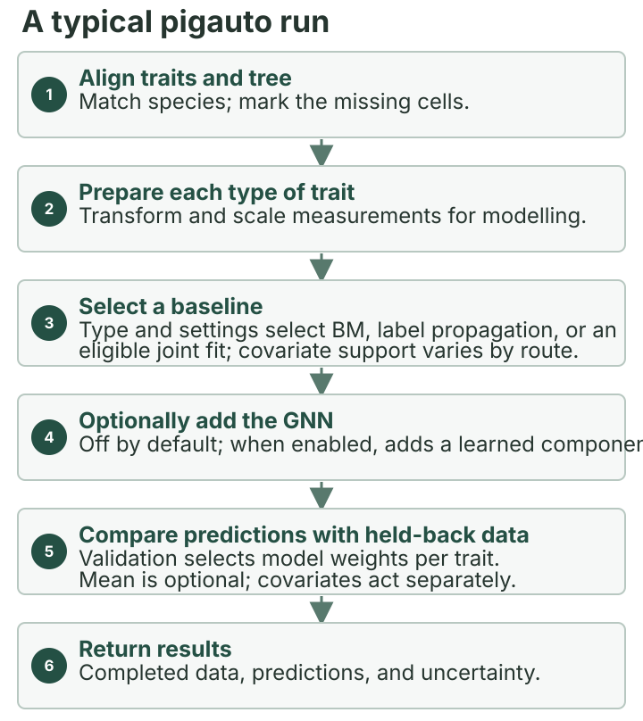

```{r setup, include = FALSE}
knitr::opts_chunk$set(
  collapse = TRUE,
  comment = "#>",
  eval = FALSE
)
```


This article answers a practical question: what happens between
`impute(traits, tree, covariates = covariates)` and the returned
`pigauto_result`? It follows the data through the phylogenetic baseline,
the optional graph neural network (GNN), calibration, and uncertainty
summaries. It keeps the mathematical detail while explaining which choices
depend on the input and which claims are supported by current evidence.

Here, calibration means using observed values held out for validation to choose,
separately for each trait, how much its prediction uses the phylogenetic baseline,
the optional GNN, and an optional mean prediction. Any direct covariate effect is
added separately; it is not part of these weights. The weights reflect held-out
performance; they do not guarantee accuracy for missing values.

The default is `gnn = FALSE`. In a bounded study, a fitted model predicted
held-out values better than a same-fit version with its neural contribution
removed, in two repeated-observation scenarios with environmental covariates.
In that comparison, the neural weight moved to the Brownian component; the
fitted mean weight and covariate effect stayed fixed. This tests the neural
contribution within those fitted models. It does not compare separately
refitted `gnn = TRUE` and `gnn = FALSE` models or establish a general
improvement. See the [validation results and limits](validation-results.html)
for the tested settings. With
those limits in mind, you can decide whether to test the optional GNN on
your data.

A phylogeny represents evolutionary relationships and branch lengths.
Brownian motion (BM) is a model in which a trait changes gradually and
randomly along those branches. A graph neural network (GNN) lets each
species combine information from other species. It learns how much to use
each species. Before that learned weighting, a starting bias favors
shorter evolutionary distances. The equations remain available below for
readers who want the implementation detail.

## A biologist's route through this article

This page explains what pigauto does after you have prepared a trait table and
matching phylogeny; it is not the first-run setup guide. If you still need to
align species names, check trait types, or install the package, start with
[Getting started](getting-started.html), then use the
[mixed-types guide](mixed-types.html) to declare measurements. Return here to
understand the prediction and its limits.

Keep one question in mind: a trait has been measured for some species, is
missing for others, and a phylogeny is available. The goal is to estimate the
missing values while keeping predictions and uncertainty in their
proper roles.

1. **Start with the tree and trait table.** See [Getting started](getting-started.html)
   for preparing and running them, and [Mixed trait types](mixed-types.html)
   for how pigauto handles different measurements.
2. **Start with a phylogenetic baseline prediction.** pigauto selects a
   method based on the trait types and available methods. For numeric traits,
   Brownian motion uses observed values and evolutionary relationships.
   For binary and categorical traits, label propagation borrows information
   from observed relatives. When supported, a joint model also uses
   relationships among traits. You usually do not need to choose these routes
   yourself. The [mixed-types guide](mixed-types.html) explains trait
   declarations and route limits.
3. **Decide whether to test the optional GNN.** It is off by default. A
   bounded evaluation found gains over a same-fit neural-off counterfactual
   in two repeated-observation settings with environmental covariates. That
   ablation isolates the fitted neural contribution; it is different from
   comparing separately refitted `gnn = TRUE` and `gnn = FALSE` models and
   does not establish a general advantage. To compare the two fitted options
   on your data,
   follow the paired example below or the [held-out workflow in Getting started](getting-started.html#step-2-create-evaluation-splits):
   `cross_validate()` temporarily masks observed values in each fold. Run it
   with the same seed for both options so they use the same held-out values.
   The [validation results](
   validation-results.html#when-does-the-neural-component-add-predictive-value)
   explain the tested settings and limits. Compare other methods only when
   they address the same biological question and prediction task.
4. **Treat validation as a comparison, not a guarantee.** Held-out observed
   values help assess predictions and select component weights. That result
   does not guarantee accuracy for species whose values are missing.
5. **Choose the output for your question.** A completed value is a
   prediction. Per-cell uncertainty summaries have route- and trait-specific
   meanings. Downstream inference needs an eligible multiple-imputation
   method; prediction-diagnostic draws are not a substitute. See
   [Uncertainty quantification](#uncertainty-quantification) and
   [Multiple imputation](multiple-imputation.html).

## Run and check your own data

Start with a data frame called `traits` and a matching `phylo` object called
`tree`. Put species names in `rownames(traits)` and keep unknown measurements
as `NA`. For repeated observations, use a `species` column and follow the
multi-observation instructions in [Getting started](getting-started.html).

```r
library(pigauto)
check <- check_pigauto(traits, tree)
print(check)
check$messages                    # review messages and suggested actions
if (check$status == "not_needed") {
  message("All matched target cells are observed; no imputation is needed. Use cross_validate() to assess prediction.")
} else if (!check$ready) {
  stop(sprintf(
    "Input check status is '%s'; review check$messages and fix the reported problems.",
    check$status
  ))
} else {
  result <- impute(traits, tree)   # GNN is off by default
  completed <- completed_data(result)

  colSums(is.na(completed))        # missing values remaining, by trait
  which(is.na(completed), arr.ind = TRUE)  # their row and column positions
}
```

`check_pigauto()` checks inputs without fitting a model. Review its messages
and actions before fitting, even when the inputs are marked ready. If species
names do not match, inspect `check$species$matched`, `check$species$data_only`,
and `check$species$tree_only`; the [Getting started guide](getting-started.html)
explains how to align them. `completed` keeps observed values and fills
modeled missing cells when predictions are available. If any `NA` remains,
inspect the reported rows and traits and resolve the input or prediction issue
before treating the table as complete. If you inspect
`result$prediction$se`, remember that this field does not have one meaning
across all traits and routes: for binary and categorical traits it is
an uncertainty score, not a standard error for Rubin's rules. See the
[uncertainty guide below](#uncertainty-quantification). For the full held-out
comparison and setup, follow [Getting started](getting-started.html).

For a paired baseline-versus-GNN comparison, `cross_validate()` divides the
observed values into groups called *folds*. In each iteration, it reserves one
fold for testing and the next fold for validation, fits on the remaining
folds, and scores the test fold. Reusing the same seed gives both options the
same fold assignments, so their test scores can be compared fairly. The
example below uses one row per species and no
environmental covariates. For repeated rows, set `species_col` in
`preprocess_traits()`. For environmental predictors, pass `covariates` to
`preprocess_traits()`. You can use either option or both. Prepare the data
once with
[`preprocess_traits()`](https://itchyshin.github.io/pigauto/reference/preprocess_traits.html),
then pass that prepared object to both calls.

Read each metric returned by `cross_validate()` in its own direction: lower
RMSE, MAE, or Brier score is better; higher accuracy or correlation is better.
Compositional distance is reported by `evaluate_imputation()` for
multi-proportion traits, not by this cross-validation summary.
For `coverage_95`, compare the estimate with the intended coverage level
rather than simply looking for a larger value. The `sd` columns describe
variation across folds and, when multiple seeds are used, across seeds in
this run. They do not measure uncertainty about a biological effect.
Compare rows with the same trait and metric:

```r
pd <- preprocess_traits(traits, tree)
cv_baseline <- cross_validate(pd, tree, k = 5L, seeds = 1L,
                              epochs = 100L, gnn = FALSE, verbose = FALSE)
cv_gnn <- cross_validate(pd, tree, k = 5L, seeds = 1L,
                         epochs = 100L, gnn = TRUE, verbose = FALSE)

keys <- c("trait", "type", "metric")
comparison <- merge(
  cv_baseline$summary[, c(keys, "mean", "sd")],
  cv_gnn$summary[, c(keys, "mean", "sd")],
  by = keys, suffixes = c("_baseline", "_gnn")
)
comparison
```

This small example fits ten models in total (five folds and two options),
with a maximum of 100 training epochs to check the workflow; training may stop
earlier if its stopping rule is met. Treat these scores as exploratory, not as
final evidence. A fuller comparison needs more folds, seeds, and an adequate
training limit, and will take longer. The same folds make the
comparison paired; they do not guarantee accuracy for values that are missing. See [`cross_validate()`](https://itchyshin.github.io/pigauto/reference/cross_validate.html) for
arguments and returned metrics.

If you choose to try the optional GNN on your own data, request it explicitly:

```r
result_gnn <- impute(traits, tree, gnn = TRUE)
completed_gnn <- completed_data(result_gnn)
```

This produces a second set of predictions; it does not show that the GNN
improves accuracy for your data. Use the held-out comparison above to
evaluate predictive performance.

The full technical map and equations follow for readers who want to see how
the package implements these steps.

<picture>
  <source srcset="figures/pigauto-workflow-overview-mobile.svg" media="(max-width: 640px)">
  
</picture>

*Figure 1. The optional GNN is off by default; baseline eligibility and
covariate use depend on the selected route.*

## 1. End-to-end data flow (technical map)

`impute()` chains six internal stages. In the map, $n$ is the number of
observations, $m$ the number of species, and $p$ the number of model columns
after trait types have been encoded. $k$ counts features that summarize
tree structure, $c$ counts covariates, and $T$ is the number of alternative
trees used in a prediction-sensitivity sample. With repeated observations,
$n$ can exceed $m$.

1. **Prepare traits and optional covariates.** The trait table has $n$ rows
   and $p_{traits}$ measured columns; an optional covariate table has $n$
   rows and $c$ columns. Unknown trait values are `NA`. When you set
   `species_col`, repeated rows map to $m$ species. `preprocess_traits()`
   encodes the measurements into `X_scaled` ($n \times p$), records how to
   decode them in `trait_map`, and stores the observation-to-species map.
2. **Build features from the tree.** `build_phylo_graph()` returns `coords`
   ($m \times k$, mathematical summaries of how each species relates to the
   others across the tree; these are not map coordinates), `adj` ($m \times m$,
   weights linking species according to their tree distances), and `D_sq`
   (squared pairwise tree distances).
3. **Choose and fit a baseline.** `fit_baseline()` returns `mu`, the
   route-specific baseline prediction, and `se`, an uncertainty output whose
   meaning depends on the route. Some routes combine repeated observations
   before fitting at species level.
4. **Optionally train the GNN.** `fit_pigauto()` can hide selected observed
   cells during training and learn to predict them. This step is disabled by
   default in `impute()`.
5. **Calibrate component weights.** `calibrate_gates()` selects weights
   using held-out observed cells; this is a prediction comparison, not a
   guarantee for cells whose values are missing.
6. **Return predictions.** `predict.pigauto_fit()` combines the available
   baseline, GNN, mean, and covariate components, then maps predictions back
   to observation rows when needed. `impute()` returns these with the
   completed data and missing-cell mask.
In biological terms, `coords` summarize broad and fine-scale groupings in the
tree. `adj` gives closer relatives stronger links than distant species.
`D_sq` stores squared tree distances used to set how quickly attention weakens
with evolutionary separation. These features describe the tree; the model also
uses trait values, missingness indicators, and any supported covariates.

The figure is an implementation map. The next section explains the
phylogenetic reference prediction in biological terms before deriving its
conditional equations.

## 2. The phylogenetic baseline

The baseline dispatcher in `fit_baseline()` selects a route by trait type
and the available model dependencies. Its output `mu` is the baseline
prediction on the route's latent or output scale. The meaning and
availability of `se` depend on that route: numeric Brownian-motion routes
return conditional standard deviations, while label-propagation and some
joint threshold/one-vs-rest routes do not provide the same uncertainty
quantity. These baseline outputs are distinct from the final `pred$se`,
which is type-dependent and may be an uncertainty score rather than a
standard error. A point prediction fills missing cells; posterior draws
for multiple imputation are a separate workflow with additional eligibility
conditions.

### 2.1 Continuous, count, ordinal, proportion: Brownian motion

For one continuous trait $y$ with $y_O$ observed and $y_M$ missing,
$y \sim \mathcal{N}(\beta \mathbf{1},\, \sigma^2 \mathbf{R})$ under BM
on the species tree (Felsenstein, 1985), where
$\mathbf{R} = \mathrm{cov2cor}(\mathrm{vcv}(\text{tree}))$ is the phylogenetic
correlation matrix. With model parameters held fixed, the Gaussian conditional mean and
marginal variances for missing values are:

<div class="math-overflow-region" role="region" aria-label="Brownian-motion conditional mean and variance">

$$
\begin{aligned}
\hat{\mu}_M &= \beta \mathbf{1} + \mathbf{R}_{MO} \mathbf{R}_{OO}^{-1} (y_O - \beta \mathbf{1}_O), \\
\widehat{\sigma}^2_{M|O} &= \sigma^2\bigl(1 - \mathrm{diag}(\mathbf{R}_{MO} \mathbf{R}_{OO}^{-1} \mathbf{R}_{OM})\bigr).
\end{aligned}
$$

</div>

Here, $O$ indexes species with observed values and $M$ indexes species with
missing values. The parameter $\beta$ is the fitted overall trait mean, and
$\sigma^2$ is the fitted Brownian variance on the modelled scale. The matrix
block $\mathbf{R}_{MO}$ describes relationships between missing and observed
species; $\mathbf{R}_{OO}$ describes relationships among observed species.
The first equation adjusts the overall mean using observed departures from it
and their evolutionary relationships. The second gives a conditional variance
for each missing value, with model parameters held fixed.

`R/bm_internal.R::bm_impute_col()` substitutes a generalized
least-squares (GLS) estimate of $\beta$ and an estimated $\sigma^2$.
These conditional variances do not propagate uncertainty in the fitted
parameters. Count
traits are log1p-transformed, ordinal traits are coerced to integers and
z-scored, proportions are logit-z-scored. The same conditional formula
is used in each transformed space.

These equations describe the per-column Gaussian calculation. In the
implementation, a small diagonal term is added to the observed-species
correlation block for numerical stability. With fewer than five observed
values, or if the matrix factorisation still fails after increasing that term,
the baseline uses the observed mean and standard deviation where available.
If no values are observed, the fallback uses mean 0; if fewer than two are
observed, it uses standard deviation 1.
The equations show the fixed-\(\lambda=1\) calculation. Other
`lambda_mode` settings modify the correlation matrix. Pagel (1999) provides
background on phylogenetic comparative methods, not validation of these
package-specific estimators. Bayesian lambda
averaging also includes variation among its conditional predictions.

### 2.2 Binary and categorical: phylogenetic label propagation (LP)

Discrete traits use a softer phylogenetic prior: each species's class
probability is a kernel-weighted average over observed neighbours,
$\Pr(y_i = k) \propto \sum_{j} \mathbf{A}_{ij} \, \mathbb{1}(y_j = k)$,
where weights are based on Gaussian functions of phylogenetic distance.
Label propagation excludes the focal species and normalizes over observed
neighbours. The GNN instead uses a symmetrically normalized adjacency with
self-loops.
For categorical traits with $K$ classes this returns $K$ log-probability
columns; binary returns one logit column.

### 2.3 Joint multivariate Brownian baseline

When at least two eligible latent columns exist, pigauto can fit a joint
multivariate Brownian-motion (BM) baseline. After aggregation to species
when a species has repeated observations, let $m$ be the number of species
and $p$ the number of eligible latent columns. Let $\mathbf{Y}$ be the
$m \times p$ matrix of their values. Under joint BM,
<div class="math-overflow-region" role="region" aria-label="Joint Brownian-motion distribution equation">

$$
\begin{gathered}
\boldsymbol{\mu} = \mathrm{vec}(\mathbf{1}_m\beta^{\top}),\\
\mathrm{vec}(\mathbf{Y}) \sim \mathcal{N}(\boldsymbol{\mu},
  \mathbf{\Sigma} \otimes \mathbf{R}),
\end{gathered}
$$

</div>
where $\mathbf{R}$ is the $m \times m$ phylogenetic correlation matrix,
$\beta$ is a length-$p$ vector of means, and
$\mathbf{\Sigma}$ is the cross-trait covariance matrix. The default
in-house solver estimates cross-trait covariance and uses it in joint
predictions. An
optional `joint_solver = "rphylopars"` backend requires `Rphylopars`
(Goolsby et al., 2017);
if it is unavailable or unusable, pigauto falls back to the in-house
solver. With `predict_method = "auto"`, pigauto compares eligible joint
and per-column predictions on held-out cells and selects a route for
each trait. Eligibility limits and numerical fallbacks can also select
the per-column route.

The default single-pass estimate includes a correction for uncertainty
in missing cells:
$$
\begin{aligned}
\widehat{\mathbf{\Sigma}}
&= \frac{1}{m}\Bigl(
   \widehat{\mathbf{L}}^\top
   \mathbf{R}^{-1}\widehat{\mathbf{L}} \\
&\quad + \operatorname{diag}\bigl(
   \sum_i v_{i1},\ldots,\sum_i v_{ip}
   \bigr)\Bigr),
\end{aligned}
$$
where $\widehat{\mathbf{L}}$ is the completed $m \times p$ liability matrix and
$v_{ij}$ is the posterior variance for cell $(i,j)$. The divisor is the number of species, $m$. This describes
the implemented estimator; the formula alone does not establish its
statistical properties. `lambda_mode` modifies the phylogenetic
correlation matrix $\mathbf{R}$ used by the joint solver.

### 2.4 Joint baseline for binary and ordinal traits

To include binary traits in the joint model, pigauto's
`fit_joint_threshold_baseline()` uses a threshold-liability model:
each observed binary cell $y \in \{0, 1\}$ is replaced by the
posterior mean of an underlying continuous *liability* $L$ truncated by
$y$. With prior $L \sim \mathcal{N}(0, 1)$ this is the standard
truncated-normal mean. The resulting matrix is then handed to the
selected joint solver. Binary posteriors are
decoded back to probabilities via
$p = \Phi\bigl(\mu_L / \sqrt{1 + \sigma_L^2}\bigr)$, clipped to
$[0.01, 0.99]$. Ordinal liability uses $K-1$ interval cuts and is
decoded to the z-scored integer-class scale used by the network.

### 2.5 Categorical traits: one-vs-rest fits

The one-hot columns for a $K$-class trait are linearly dependent, so
putting all $K$ class liabilities into one joint fit is rank-deficient and
unstable. pigauto instead runs $K$ independent threshold-joint fits — class
$k$ vs the rest — and renormalises their probabilities into a distribution
that sums to one. The one-vs-rest result reported for BACE is evidence about
BACE's analysis, not an accuracy claim for pigauto.

### 2.6 Multiple observations per species

When each species has multiple observations, baselines run at species
level. Aggregation keeps the summary appropriate to each kind of measurement:
it averages numeric values and encoded ordered scores, uses the majority class
for yes/no traits, and selects the most frequent category for multi-class
traits.
An opt-in soft path preserves evidence strength: a species
observed as class 1 in 6/10 rows uses the convex combination
$$
\begin{aligned}
&p \cdot E[L \mid L > 0] \\
&\quad + (1 - p) \cdot E[L \mid L < 0]
\end{aligned}
$$

instead of
collapsing to hard class 1. Hard aggregation is the default; set
`multi_obs_aggregation = "soft"` to retain evidence strength across repeated
observations.

## 3. The optional graph neural network

The optional GNN learns a full per-cell prediction, `delta`, that is blended
with the phylogenetic baseline. During training, pigauto temporarily hides
selected observed cells and asks the network to predict them. This training
strategy is called a denoising autoencoder (DAE). Despite the internal class
name, `delta` is not a statistical residual $y - \mu$; it is a full
prediction on the latent scale.

### 3.1 Encoder

Input tensors:

* `x` $\in \mathbb{R}^{n \times p}$ — trait context filled with the
  baseline prediction. During training, selected observed cells are
  replaced by a learnable mask token so the network learns to reconstruct
  them.
* `coords` $\in \mathbb{R}^{m \times k}$ — species-level spectral
  Laplacian features. For repeated-observation input, pigauto maps these to
  `coords_obs` $\in \mathbb{R}^{n \times k}$ using `obs_to_species`. With
  one row per species, `coords_obs` equals `coords`.
* `covs` contains the baseline predictions, a row-level corruption
  indicator, and encoded user covariates. Its column count depends on the
  latent trait dimension and the supplied covariates.

If `use_trait_attention = TRUE` (see §3.5), a pooled
trait-context feature of dimension `trait_embed_dim` is also
concatenated. The encoder is a two-layer MLP:

<div class="math-overflow-region" role="region" aria-label="Graph neural network encoder equation">

$$
\begin{aligned}
z &= \mathrm{concat}(x, \text{coords}_{\mathrm{obs}}, \text{covs}, \ldots),\\
h &= \mathrm{ReLU}(\mathbf{W}_2 \, \mathrm{Dropout}(\mathrm{ReLU}(\mathbf{W}_1 z))),
\end{aligned}
$$

</div>

producing $h \in \mathbb{R}^{n \times h_d}$ with hidden dim
$h_d$ (default 64).

When `species_col` selects observation-level input, $h$ is averaged
across observations of the same
species (`scatter_mean`) to produce a species-level hidden state
$h_\text{species} \in \mathbb{R}^{m \times h_d}$ for the graph message
passing, then broadcast back to observation level afterwards.

### 3.2 Graph transformer block

The default path stacks $L$ pre-norm transformer encoder blocks
(`n_gnn_layers`, default 2). Each block has:

* Multi-head attention (`n_heads` default 4) over the $m$ species, with
  a **per-head learnable phylogenetic bias** added to the attention
  scores. With $\mathbf{D}^2$ the squared cophenetic-distance matrix
  and $\beta_h = \mathrm{softplus}(\mathrm{log\_bw}_h)$ a learned
  bandwidth per head, the bias is
  $\mathbf{B}_h = -\mathbf{D}^2 / (2\beta_h^2)$. Different heads can learn
  narrower or broader distance scales. This is a
  package-specific distance bias. Graphormer
  provides broader context for graph-aware attention biases (Ying et al.,
  2021), but uses a different bias. The scaled dot-product attention follows
  the standard transformer formulation (Vaswani et al., 2017).
* A position-wise FFN with width $h_d \cdot \mathtt{ffn\_mult}$ (default
  4). Its output projection starts at zero, so this residual contribution
  starts at zero; the attention residual remains active. The position-wise
  feed-forward block is a standard transformer component (Vaswani et al.,
  2017).
* Layer norm before each sub-block, residual skips after each.
* Optional per-layer covariate injection (when user covariates are
  present): `cov_h = cov_encoder(user_covs)` is added inside the block
  via a learnable projection, so covariate features are visible at
  every depth, not just the encoder.

The lower-level `fit_pigauto()` interface can use a single-head attention
stack by setting `use_transformer_blocks = FALSE`.

### 3.3 Decoder and the gate

A symmetric two-layer MLP maps the species-broadcast hidden state back
to the latent space: `delta = dec2(ReLU(dec1(h)))` of shape
$n \times p$.

During training, the model uses a learned per-column neural gate:

This gate controls how much the GNN prediction contributes: a larger gate
gives the GNN more weight and the baseline less, up to but not including
`gate_cap`.

$$
\begin{aligned}
r &= \sigma(\rho) \cdot \mathtt{gate\_cap},\\
r &\in (0, \mathtt{gate\_cap}),
\end{aligned}
$$

with $\rho \in \mathbb{R}^p$ a learnable per-column parameter. The model
output is

$$
\begin{aligned}
\hat{x} &= (1 - r) \cdot \mu + r \cdot \mathrm{delta}\\
&\quad + \mathrm{cov\_linear}(u),
\end{aligned}
$$

where $f_{\mathrm{cov}}(u)=\mathrm{cov\_linear}(u)$ is the direct linear
contribution from user covariates, or zero when none are supplied. It remains
active when the neural gate is zero. In the training code this contribution
is returned as `fixed_effects` and assigned to `fixed`.

With `gnn = TRUE`, user covariates also enter the network. Whether the
phylogenetic baseline uses them depends on the selected route: a covariate-
aware per-column numeric Brownian-motion fit can include them. Joint MVN and threshold-joint routes omit covariates and emit a separate baseline
warning. One-versus-rest categorical routes also omit covariates but do not
trigger that warning themselves. In a mixed fit, another selected joint route can
still trigger it.

Training starts with effective gates of 0.135 for continuous-family
columns and 0.10 for discrete columns, including ordinal and the
zero/nonzero gate. Validation recalibration later chooses prediction
weights for the available components.

### 3.4 Training objective and regularization

For each training batch, the masked-cell prediction, blend and shrinkage
terms use observed values that pigauto temporarily hides from the network input.
The model then tries to recover those known values. In plain language, the
first term trains the GNN prediction (plus the direct covariate contribution)
to predict them; the smaller second term trains the combined prediction. The
shrinkage term discourages the GNN prediction from moving too far from the
phylogenetic baseline, and the gate penalty discourages large GNN weights.
These costs are combined as follows:

$$
\begin{aligned}
\mathcal{L} ={}& \mathcal{L}_\text{type}(\mathrm{delta} + \mathrm{fixed}, y_\text{true}) \\
&+ 0.1\,\mathcal{L}_\text{type}(\hat{x}, y_\text{true}) \\
&+ \lambda_\text{shrink} \cdot \mathrm{MSE}(\mathrm{delta} - \mu) \\
&+ \lambda_\text{gate} \cdot \mathrm{MSE}(r).
\end{aligned}
$$

* $\mathcal{L}_\text{type}$ dispatches by trait type: MSE for continuous /
  count / ordinal / proportion, BCE for binary / zi-gate, cross-entropy
  for categorical, MSE on CLR for multi-proportion.
* $\lambda_\text{shrink}$ (default 0.03) penalises `delta` drifting away
  from the baseline.
* $\lambda_\text{gate}$ (default 0.01) penalizes large gates and thus
  encourages smaller neural contributions; it does not guarantee that
  fitted gates will be zero.

The gate penalty and architectural cap (`gate_cap` ≤ 0.8 by default)
regularize training. A separate validation step selects the prediction
weights used at prediction time.

### 3.5 Optional within-row cross-trait attention

The encoder above mixes all trait columns into a single hidden vector
via a linear projection, which loses per-trait identity. When
`use_trait_attention = TRUE`, the model additionally builds a
per-trait token sequence:

$$
\begin{aligned}
\text{tokens}_{i,j} &= \mathbf{W}_v \, x_{i,j} + \mathbf{e}_j, \\
j &= 1, \ldots, p,
\end{aligned}
$$

with $\mathbf{e}_j \in \mathbb{R}^{e_d}$ a learnable positional
embedding per trait column (dim `trait_embed_dim`, default 32). One
multi-head self-attention block (`n_trait_heads`, default 2) mixes
these $p$ tokens within each row $i$, followed by mean-pool to a
single $e_d$-dim feature. That feature is concatenated alongside
$(x, \text{coords}, \text{covs})$ at the encoder input.

This option changes the model architecture. In a reported BIEN plant
benchmark it did not improve pooled RMSE. In a separate 60-replicate
ablation at $N=2000$, the attention-on arms had higher z-RMSE than the
attention-off arm (1.056 and 1.057 versus 1.038); conformal coverage was
0.884–0.887. These findings apply to that tested multi-trait setting and
do not establish performance for other data. The ablation design and
implementation are documented in [issue #106](https://github.com/itchyshin/pigauto/issues/106)
and [pull request #116](https://github.com/itchyshin/pigauto/pull/116);
the [NEWS](https://itchyshin.github.io/pigauto/news/index.html) page records the results. Benefit when the
joint covariance model is inadequate has not been established.

## 4. Validation-based calibration

After training, pigauto selects weights separately for each trait using
held-out validation cells. The weights say how much that trait's prediction
uses the phylogenetic baseline, the GNN prediction, and (when enabled) the
mean baseline. They replace the network's learned gate for prediction.

Calibration searches candidate weight combinations for each trait.
Continuous and discrete traits use different losses and minimum-cell
rules. If `predict_method = "auto"` selects between baseline routes,
route selection and weight calibration are separate steps. Route
selection uses a held-out subset when enough cells are available; small
samples can reuse cells, so calibration is not independent of every
selection step.

Calibration can select zero weight for the GNN. That removes its
contribution, but a mean component or direct covariate term can remain.
The selected weights describe performance on calibration data; they do
not guarantee error on missing cells.

## 5. Putting it together: a worked predictive equation

For one continuous trait, the calibrated latent prediction combines the
available components:
$$
\begin{aligned}
z_i &= w_{\mathrm{BM}}\mu_i \\
&\quad + w_{\mathrm{GNN}}\delta_i \\
&\quad + w_{\mathrm{mean}}m + f(u_i),
\end{aligned}
$$
where the weights are selected on validation cells, $m$ is the mean
baseline when that option is enabled, and $f(u_i)$ is the direct
covariate contribution. A zero neural weight removes only the GNN term.
For an arithmetic illustration, suppose an untransformed continuous trait has
a baseline prediction of $0.5$ and a GNN prediction of $1.0$ on the
standardised scale. If the GNN is enabled and validation selects weights
$w_{\mathrm{BM}}=0.8$ and $w_{\mathrm{GNN}}=0.2$, with no mean or covariate
contribution, then $z_i=0.8(0.5)+0.2(1.0)=0.6$. With an original-scale mean
of $100$ mm and standard deviation of $20$ mm, the prediction is
$100+20(0.6)=112$ mm. These values illustrate the arithmetic only; they are
not fitted results or recommended weights. The package's default is
`gnn = FALSE`.

For a standardized trait with mean $a$ and standard deviation $b$, the
original-scale prediction is
$$
\hat{y}_i = g^{-1}(b z_i + a),
$$
where $g^{-1}$ reverses any log or logit transformation. If the latent
interval half-width is $q$, transform both limits:
$$
\begin{aligned}
&\bigl[g^{-1}\{b(z_i-q)+a\}, \\
&\quad g^{-1}\{b(z_i+q)+a\}\bigr].
\end{aligned}
$$
Do not add a latent-scale prediction or half-width directly to the
original-scale response unless the trait is untransformed and unscaled.
Treat the interval as a nominal held-out diagnostic under the stated
conditions, not a package-wide coverage certification.

## 6. Uncertainty quantification

Start with the question you need to answer:

::: {.pa-uncertainty-table}
| Your question | Output to inspect | What it tells you |
|---|---|---|
| Which cells were missing, and what did pigauto complete? | `result$completed` and `result$imputed_mask` | The mask marks missing targets; some can remain `NA` when no prediction is available, so check the completed table. |
| How wide is a single prediction interval? | `result$prediction$conformal_lower` and `result$prediction$conformal_upper` | When a finite score is available, bounds are returned for continuous, count, ordinal, proportion, and `zi_count` traits. For `zi_count`, they describe positive-count magnitude conditional on a nonzero value; use `result$prediction$probabilities` for the nonzero probability. Bounds are unavailable for binary, categorical, and `multi_proportion` traits. These are nominal held-out prediction diagnostics, with limitations described below. |
| How does the model's uncertainty vary across cells? | `result$prediction$se` | A route- and trait-specific quantity; for binary and categorical traits it is an uncertainty score, not a standard error. For ordinal traits on the threshold-joint route, zero is a placeholder; it does not mean certainty. |
| How uncertain is a downstream biological effect? | An eligible multiple-imputation analysis | Do not infer this from completed values or prediction-diagnostic draws. Check the [multiple-imputation guide](multiple-imputation.html) for supported methods, assumptions, and current evidence. |
:::

pigauto exposes distinct uncertainty mechanisms; they answer
different questions and must not be conflated.

**Baseline `pred$se` (one prediction run).**
For one prediction run (`n_imputations = 1`), numeric `pred$se` is a
route-specific model SD, not a measure of the full model's prediction
error. The per-column Brownian route uses its conditional-MVN variance;
the exact joint route uses a joint conditional variance. pigauto converts
these values back to the response scale, using the delta method for log,
log1p, and logit transformations. Fixed-lambda routes do not include
uncertainty in fitted parameters. With `lambda_mode = "bayes"` on the
per-column route, the reported variance also includes variation among
lambda-specific predictions. With multiple prediction runs,
`pred$se` uses a different, type-specific calculation that also reflects
variation among the runs. The ordinal threshold-joint route currently
returns a zero uncertainty placeholder, which is not an estimated ordinal
SE.

**`pred$se` (binary / categorical).**
$\min(p, 1-p)$ or $1 - \max_k p_k$ — an uncertainty score, **not** a
Gaussian standard error. Use it for ranking or reporting. Do **not**
plug it into Rubin's rules.

**Conformal interval (`pred$conformal_lower`, `pred$conformal_upper`).**
Read these as nominal prediction diagnostics for each supported trait, not
as a general 95% coverage guarantee for the cells you intend to impute. In
the GNN route, validation cells help select the model and calibrate its gate;
`conformal_split_val = TRUE` does not create a fully untouched calibration
set because early stopping has already used validation data. The observed
cells must also represent the cells whose values are missing. These bounds
apply one trait at a time: they are not simultaneous guarantees across the
completed dataset, confidence intervals for model parameters, or uncertainty
intervals for downstream effects. Check coverage on a holdout design that
matches the intended use.

For eligible continuous traits, `multi_impute()` defaults to posterior
draws. Automatic selection requires one row per species, supported
continuous traits, and no user covariates or `species_col`. This sampler
fits its own phylogenetic model; it does not use the pigauto baseline or GNN
and does not require a usable single-tree joint baseline. It uses MCMC, so
check convergence and inspect the returned diagnostics. The documented
downstream route is limited to analyses that are linear in the jointly
imputed traits on their imputation scale and use only those traits. It does
not cover external covariates, nonlinear terms or interactions, or analysis
of a log-imputed trait on its raw scale. `with_imputations()` does not
inspect the fitting formula for these conditions. This route differs from
`multi_impute_analysis()`, which declares a supported downstream model,
and from prediction-diagnostic draws. A posterior sampler does not by
itself establish validity for every downstream analysis.
In the registered validation, five of eight posterior-slope regimes failed
and three were indeterminate; none met the support criteria. These results
describe the tested settings, not every possible use. See the
[registered inferential results](validation-results.html#inferential-results)
for the regimes and criteria.

With `draws_method = "auto"`, `multi_impute()` selects posterior draws
when every trait is continuous and you supply no `covariates`, `species_col`,
or `multi_proportion_groups`. If one of those route-selection conditions is
not met, it selects conformal draws. This selection does not guarantee that
the posterior run can proceed: it errors if there are no missing cells or if
a trait has fewer than two observed values.

Conformal draws are prediction diagnostics, not proper multiple imputations.
For continuous, count, ordinal, and proportion traits, a finite conformal
score sets the Normal-draw standard deviation to that score divided by 1.96
on the trait's transformed latent scale. When no finite conformal score is available for these traits, pigauto uses
the reported `pred$se` as a scale input for fallback draws. For log-transformed continuous
traits, log1p-transformed counts, and logit-transformed proportions, `pred$se`
is reported on the original scale, but the draw is made on the transformed
scale. Pigauto does not fully convert `pred$se` between these scales, so
diagnostic draw spread may be too wide or too narrow. Fitted point predictions
are unchanged. Binary and
categorical traits instead use their predicted class probabilities, while a
zero-inflated count uses one draw to choose between the zero part and the
count part. A separate draw sets the count size. After rounding, any negative
size is set to zero, so the count part can also return zero. These cell-wise
draws do not establish joint
phylogenetic posterior uncertainty. `draws_method = "mc_dropout"` also
returns prediction diagnostics: it perturbs latent cells using the selected
baseline standard deviation and, when the GNN is enabled, varies network
outputs across dropout runs. Neither diagnostic route is supported for
downstream inference.

The separate experimental `multi_impute_analysis()` backend declares the
substantive model before imputation. It supports one incomplete continuous
covariate under MAR, dispatching to proper Bayesian normal-regression MI for
Gaussian `lm`, `smcfcs` for binomial-logit `glm`, and `jomo.smc` for a Gaussian
`lmer` with one random intercept. `pool_mi()` then applies Rubin's rules
(Rubin, 1987) to
fixed effects only. The interface remains experimental and deliberately
narrow.
For broader ecological discussion of missing data and imputation, see
Nakagawa and Freckleton (2008, 2011); these papers do not validate this
package's procedures.

### Technical details: conformal calibration

For general conformal-prediction background, see Vovk et al. (2005). For
absolute residuals on held-out validation cells, the code sets the
quantile probability to
$\min\{\lceil(1-\alpha)(n_\mathrm{val}+1)\rceil/n_\mathrm{val},1\}$
and calls R's default interpolating `stats::quantile()` (type 7). This
probability is motivated by the finite-sample conformal rank; the interpolated
quantile need not equal the theorem's order statistic. Route selection and
weight calibration also use validation data, and small samples may reuse
cells for calibration and scoring. Predictions from the production refit use
a procedure trained on the observed cells, so the held-out score does not by
itself certify coverage for that refit. Treat this as a nominal held-out
prediction diagnostic. Standard split-conformal coverage requires
exchangeability and a fixed prediction procedure, conditions not established
for every setting here. At nominal 95% coverage, when only 1–18 finite
validation scores remain, pigauto’s split-conformal route uses the largest
observed score as its
threshold. This finite cap does not retain the standard split-conformal 95%
guarantee; the standard construction instead uses an infinite threshold,
returning the whole outcome space. For `conformal_method = "split"` at nominal 95% coverage, let `n_val` be the
number of finite validation residuals remaining for this scored trait after
filtering. When `n_val >= 19`, R's type-7 quantile is at least the `k`-th
ordered absolute-residual score, where `k = ceiling(0.95 * (n_val + 1))`.
Thus type-7 interpolation alone does not lower the usual split-conformal
marginal-coverage bound under the standard assumptions (Lei et al. 2018,
Theorem 2). Those assumptions include exchangeability and use of the same
fitted prediction model, fitted without calibration outcomes, to score
calibration residuals and future cases. They are not established for
pigauto's full procedure: validation observations inform route selection
and gate calibration; with `gnn = FALSE` and the default
`baseline_full = NULL`, production prediction uses a baseline fit with
`splits = NULL` on all observed cells, rather than the held-out baseline
used to compute calibration residuals. The interval is not an MI draw
distribution.


## 7. Posterior-tree prediction sensitivity

`multi_impute_trees()` can compare point predictions across a posterior tree
sample. Use its output to describe how predictions change with tree choice;
do not interpret that variation as uncertainty for downstream model estimates.
Inferential approaches to tree uncertainty are discussed by Nakagawa and
de Villemereuil (2019), but this package workflow reports sensitivity only;
tree-sensitivity results are not supported for downstream inference. See the
[tree-sensitivity guide](tree-uncertainty.html) for a step-by-step example.

## 8. Where to look in the code

| Concept | File |
|---------|------|
| BM kernel + conditional MVN | `R/bm_internal.R` |
| Joint MVN baseline | `R/joint_mvn_baseline.R` |
| Threshold-joint (binary + ordinal) | `R/joint_threshold_baseline.R`, `R/liability.R` |
| One-versus-rest categorical | `R/ovr_categorical.R` |
| Graph transformer block | `R/graph_transformer_block.R` |
| GNN model (`ResidualPhyloDAE`; ResNet-style skip connections, not a statistical residual) + optional trait attention | `R/model_residual_dae.R` |
| Training loop, gate calibration | `R/fit_pigauto.R`, `R/fit_helpers.R` |
| Prediction, conformal intervals | `R/predict_pigauto.R` |
| Analysis-aware MI and fixed-effect pooling | `R/multi_impute_analysis.R`, `R/pool_mi.R` |
| Prediction-diagnostic draws | `R/multi_impute.R`, `R/predict_pigauto.R` |
| Experimental tree-sensitivity workflow | `R/multi_impute_trees.R` |

## References

Author-year citations in the text identify the claims for which each source
is relevant. Package-specific implementation statements were checked against
the source files listed above; the cited papers do not certify pigauto's full
procedure or its inferential validity.

- Lei, J., G'Sell, M., Rinaldo, A., Tibshirani, R. J., & Wasserman, L.
  (2018). *Distribution-Free Predictive Inference for Regression.*
  Journal of the American Statistical Association, 113(523), 1094–1111.
  [https://doi.org/10.1080/01621459.2017.1307116](https://doi.org/10.1080/01621459.2017.1307116).

- Felsenstein, J. (1985). *Phylogenies and the comparative method.*
  The American Naturalist, 125(1), 1–15.
  [https://doi.org/10.1086/284325](https://doi.org/10.1086/284325).
- Pagel, M. (1999). *Inferring the historical patterns of biological
  evolution.* Nature, 401, 877–884.
  [https://doi.org/10.1038/44766](https://doi.org/10.1038/44766).
- Goolsby, E. W., Bruggeman, J., & Ané, C. (2017). *Rphylopars: fast
  multivariate phylogenetic comparative methods for missing data and
  within-species variation.* Methods in Ecology and Evolution, 8(1), 22–27.
  [https://doi.org/10.1111/2041-210X.12612](https://doi.org/10.1111/2041-210X.12612).
- Vaswani, A., Shazeer, N., Parmar, N., Uszkoreit, J., Jones, L., Gomez,
  A. N., Kaiser, Ł., & Polosukhin, I. (2017). *Attention is all you need.*
  Advances in Neural Information Processing Systems, 30.
  [Proceedings paper](https://proceedings.neurips.cc/paper_files/paper/2017/hash/3f5ee243547dee91fbd053c1c4a845aa-Abstract.html).
- Ying, C., Cai, T., Luo, S., Zheng, S., Ke, G., He, D., Shen, Y., & Liu,
  T.-Y. (2021). *Do Transformers Really Perform Badly for Graph
  Representation?* Advances in Neural Information Processing Systems, 34,
  28877–28888.
  [Proceedings paper](https://proceedings.neurips.cc/paper_files/paper/2021/hash/f1c1592588411002af340cbaedd6fc33-Abstract.html).
  This paper provides graph-structural attention context; pigauto's
  Gaussian phylogenetic-distance bias and learned bandwidths are
  package-specific.
- Rubin, D. B. (1987). *Multiple Imputation for Nonresponse in Surveys.*
  John Wiley & Sons.
  [https://doi.org/10.1002/9780470316696](https://doi.org/10.1002/9780470316696).
- Nakagawa, S., & Freckleton, R. P. (2008). *Missing inaction: the dangers
  of ignoring missing data.* Trends in Ecology & Evolution, 23(11), 592–596.
  [https://doi.org/10.1016/j.tree.2008.06.014](https://doi.org/10.1016/j.tree.2008.06.014).
- Nakagawa, S., & Freckleton, R. P. (2011). *Model averaging, missing data
  and multiple imputation: a case study for behavioural ecology.* Behavioral
  Ecology and Sociobiology, 65(1), 103–116.
  [https://doi.org/10.1007/s00265-010-1044-7](https://doi.org/10.1007/s00265-010-1044-7).
- Nakagawa, S., & de Villemereuil, P. (2019). *A general method for
  simultaneously accounting for phylogenetic and species sampling
  uncertainty via Rubin's rules in comparative analysis.* Systematic
  Biology, 68(4), 632–641.
  [https://doi.org/10.1093/sysbio/syy089](https://doi.org/10.1093/sysbio/syy089).
- Vovk, V., Gammerman, A., & Shafer, G. (2005). *Algorithmic Learning in
  a Random World.* Springer.
  [https://doi.org/10.1007/b106715](https://doi.org/10.1007/b106715).
