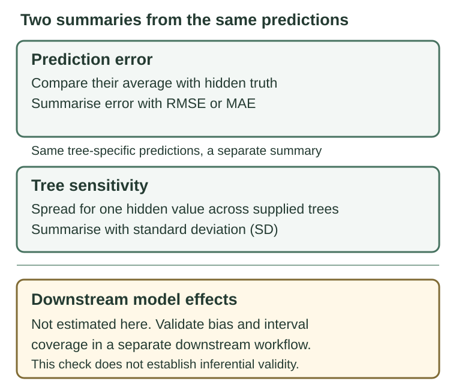

```{r setup, include = FALSE}
knitr::opts_chunk$set(
  collapse = TRUE,
  comment = "#>",
  eval = requireNamespace("torch", quietly = TRUE) &&
         isTRUE(try(torch::torch_is_installed(), silent = TRUE))
)
```

## Scope

Use this workflow to answer one question: **do predicted missing trait values
change across plausible trees?** A posterior tree sample is a set of trees
sampled to represent uncertainty about the evolutionary relationships among
species. The worked example compares one predicted value per tree; you can
request multiple draws within each tree with `m_per_tree`.

Treat the spread across trees as a prediction-sensitivity diagnostic. pigauto
does not pass these results into regression-fitting or pooling tools. The
spread tells you how predictions change across trees; it does not measure
uncertainty in a downstream effect estimate, standard error, confidence
interval, or p-value. Do not report it as any of those quantities.

These tree comparisons have not been tested as a way to quantify uncertainty
in downstream effects. The separate [validation results](validation-results.html#inferential-results)
describe other inferential settings and their limits.

Use this article if you already have several plausible trees from your
phylogenetic analysis (for example, from BEAST or MrBayes) and want to see
whether predictions for missing values change across them. BirdTree.org also
provides sets of trees.

## Supplying posterior trees

pigauto uses the tree or trees you provide. It does not download tree data
while imputing. For the 100-tree BirdTree sample available through the optional
`megatrees` package, install the package and request the sample explicitly:

```{r birdtree-download, eval = FALSE}
install.packages("megatrees")
bird_trees <- megatrees::get_tree_bird_n100()
```

An uncached request downloads the release asset through `megatrees` and needs
internet access. For a species-specific sample, use the
[BirdTree subset tool](https://birdtree.org/subsets/), then read the downloaded
Newick file with `read_tree()`. The subset tool asks for an email address and
job ID to check when the request is ready. Cite Jetz et al. (2012) for the tree
and BirdTree.org when you use its website. Record the `megatrees` version and
preserve the tree object with your analysis. For a single tree, pass the object
to `impute()`; pass a posterior sample to `multi_impute_trees()` for the
prediction-sensitivity workflow described below.

## Prediction-sensitivity workflow

Follow these steps:

1. Check species labels before masking. By default,
   `multi_impute_trees()` uses one reference tree, so the supplied trees should
   share a tip set. This set may include tips without rows in `df`; pigauto
   represents them internally with all-missing trait rows. Species in `df`
   outside the trees are not imputed for those trees. The code below scores
   only species present in every tree. If your trees have different tip sets,
   set `share_gnn = FALSE`; the example then still scores only species shared
   by all trees.

2. Choose measured trait values to test. Save their original values, then
   temporarily replace those same cells with missing values before imputation.
   Keep the saved values separate and score predictions only for the cells you
   deliberately hid.
3. Run `multi_impute_trees()` with your posterior tree sample. Here,
   `gnn = FALSE` turns off the optional neural network, so predictions use the
   phylogeny-based baseline. `m_per_tree = 1` returns one completed dataset per
   tree. This lets you compare predictions across trees, but it does not measure
   variation among repeated predictions within one tree. See the
   [function help](../reference/multi_impute_trees.html) to request multiple
   draws per tree.
4. Compare predictions for the hidden cells with their saved measurements.
   Report prediction error against those known values separately from the
   spread of predictions across trees.

The two summaries answer different questions:

<figure style="max-width: 46rem; margin: 1.5rem auto;">
<picture>
<source media="(max-width: 640px)" srcset="figures/tree-sensitivity-mobile.svg">

</picture>
<figcaption>Prediction error compares the average of available tree predictions with the hidden measurement. RMSE means root mean square error; MAE means mean absolute error. Tree sensitivity is the spread across the supplied trees, summarised here by the standard deviation (SD). Neither establishes uncertainty or coverage for downstream effects.</figcaption>
</figure>

### About the bundled tree example

The bundled `trees300` object contains 50 trees sampled from the 100-tree
BirdTree collection retrieved by `megatrees::get_tree_bird_n100()` and pruned
to the 300 AVONET species. That collection includes trees built with either
the Ericson or Hackett backbone; the original studies are Ericson et al. (2006)
and Hackett et al. (2008). Jetz et al. (2012) describes the BirdTree
distributions. Each of the 50 trees is an individual sample from the
collection. A maximum-clade-credibility tree is one summary of that collection.

The default `gnn = FALSE` fits no network and recomputes the baseline
across posterior trees. If you explicitly set `gnn = TRUE`,
`share_gnn = TRUE` (the default) trains one GNN on a reference tree and
shares it across trees. The returned datasets are for prediction-sensitivity
checks. Do not use them for downstream inference or pass them to
`with_imputations()` or `pool_mi()`; those functions reject this diagnostic
workflow.

The example hides ten measured Mass values and compares predictions only for
those cells. In a verified run with `seed = 2026`, all ten hidden values
received predictions. Their RMSE was 35.3 and their MAE was 15.9 in the
original Mass units. These are example outputs from ten selected species, not
a precise estimate of prediction accuracy. For an accuracy assessment, use a
pre-specified held-out set sized for your question and report how many
held-out species received predictions. Imputation preserves observed Mass
values, so unchanged observed values cannot show sensitivity to tree choice.

The two summaries can differ for the same species. For example, one species in
this run had a large prediction error (about 109 Mass units) and a tree-to-tree
SD of 85 units. The first number compares the mean prediction with the hidden
measurement; the second describes how much its predictions varied across the
50 supplied trees. Neither number measures uncertainty in a downstream
regression result.

To adapt the example, make a copy of your data and follow these steps. This
worked example uses one row per species:

1. Start with one row per species. Replace `data(avonet300, trees300)` with
   code that loads your data and tree list, or remove the line if those objects
   are already loaded. Change `df <- avonet300` to name your data frame, and
   replace `trees300` in the later stages with the name of your tree list.
2. If the species names are in a column, replace both uses of `Species_Key`
   with your column name. These lines move the species names to row names and
   remove that ID column from the traits. If species names are already row
   names, skip those two lines. Data and tree tip sets do not have to be
   identical. Pigauto aligns rows by species name, not by row order.
3. This scoring code is for a numeric trait like `Mass`. For another numeric
   trait, replace every `Mass` reference in Stages 1 and 3 with its column name
   and update the displayed trait label when interpreting results. Binary and
   categorical traits need different prediction scores.
4. Choose measured values to test. The code saves them as `mass_truth` before
   replacing those cells with `NA`. The example selects 10 values; change
   `n_test` to the number you want to test, up to the number of observed
   values for species present in every tree. The code stops if too few values
   are available.
   Other missing values stay missing and are not included in the error
   calculation.

The complete example was run with all 50 bundled trees; it took about 67
seconds in the recorded environment. Run the stages in order so later stages
can use the objects created earlier. Your run time will vary with hardware and
package versions.

### Stage 1: align the species labels and hide measured values

```{r canonical-align, eval = FALSE}
library(pigauto)
data(avonet300, trees300)
# Work on a copy; keep the original measurements unchanged.
df <- avonet300
# Move the species-name column to row names. Skip these two lines if your
# species names are already the row names of your data frame.
rownames(df) <- df$Species_Key
df$Species_Key <- NULL

# Set FALSE for trees with different tip sets. The default shared-reference
# route below uses a simple common-tip-set check.
share_gnn <- TRUE
if (share_gnn) {
  tip_names <- trees300[[1L]]$tip.label
  common_tip_set <- vapply(trees300, function(tree) {
    setequal(tree$tip.label, tip_names)
  }, logical(1))
  stopifnot(all(common_tip_set))
}
# Score only species represented in every tree; extra tree-only tips are okay.
common_species <- Reduce(intersect, lapply(trees300, function(tree) {
  tree$tip.label
}))
scoreable_rows <- which(!is.na(df$Mass) & rownames(df) %in% common_species)
n_test <- 10L
if (length(scoreable_rows) < n_test) {
  stop("Choose n_test no larger than the number of observed values for ",
       "species present in every tree.")
}

set.seed(2026L)
# Select measured values so predictions can be checked against their truth.
target_rows <- scoreable_rows[sample.int(length(scoreable_rows), n_test)]
mass_truth <- df$Mass[target_rows]
# Hide only these selected cells. Naturally missing values stay missing and
# cannot be scored because their true values are unknown.
df$Mass[target_rows] <- NA_real_
```

### Stage 2: predict across the supplied trees

```{r canonical-predict, eval = FALSE}
mi <- multi_impute_trees(
  df, trees = trees300, share_gnn = share_gnn, gnn = FALSE,
  m_per_tree = 1L, seed = 2026L
)
```

### Stage 3: compare predictions with the hidden measurements

```{r canonical-summarise, eval = FALSE}
mass_by_tree <- vapply(mi$datasets, function(dat) dat$Mass, numeric(nrow(df)))
heldout_predictions <- mass_by_tree[target_rows, , drop = FALSE]
finite_predictions <- is.finite(heldout_predictions)
trees_with_prediction <- rowSums(finite_predictions)
heldout_predictions[!finite_predictions] <- NA_real_
mean_prediction <- rowMeans(heldout_predictions, na.rm = TRUE)
mean_prediction[trees_with_prediction == 0L] <- NA_real_
prediction_error <- mean_prediction - mass_truth
tree_sensitivity_sd <- apply(heldout_predictions, 1L, function(x) {
  x <- x[is.finite(x)]
  if (length(x) < 2L) NA_real_ else stats::sd(x)
})
usable <- is.finite(prediction_error)
data.frame(
  species = rownames(df)[target_rows],
  observed_truth = mass_truth,
  trees_with_prediction = trees_with_prediction,
  mean_prediction = mean_prediction,
  absolute_error = abs(prediction_error),
  tree_sensitivity_sd = tree_sensitivity_sd
)
if (any(usable)) {
  c(
    usable_species = sum(usable),
    excluded_species = sum(!usable),
    RMSE = sqrt(mean(prediction_error[usable]^2)),
    MAE = mean(abs(prediction_error[usable]))
  )
} else {
  message("No held-out predictions were available; RMSE and MAE are not computed.")
}
```

Read each row as one species whose measured Mass value was temporarily hidden:

- `observed_truth` is the measured value saved before hiding it.
- `mean_prediction` is the average prediction across trees that returned a
  finite value; `trees_with_prediction` tells you how many trees contributed.
- `absolute_error` is the distance between that average prediction and the
  saved measurement.
- `tree_sensitivity_sd` is the spread in predictions across the trees. It is
  not an estimate of within-tree imputation uncertainty.

The final `RMSE` and `MAE` summarize prediction errors for held-out species
with at least one finite prediction. RMSE gives more weight to large errors;
MAE is the average absolute error. Neither measures uncertainty in a
downstream effect estimate.

These tree-level spreads do not show whether tree topology alone explains
differences between fits. Use `m_per_tree > 1` to request repeated draws
within each tree. `mi$tree_index` identifies the tree that produced each
dataset, so group by this field when summarising repeated draws; do not count
each draw as a separate tree. The draws' spread depends on `draws_method` and
its sampling assumptions. Treat it as a method-dependent diagnostic. Its use
as a posterior uncertainty interval has not been validated. In the conformal route, continuous, count, ordinal, and
proportion traits use the reported `pred$se` as a scale input for fallback draws
when no finite conformal score is available. For log-transformed continuous
traits, log1p-transformed counts, and
logit-transformed proportions, `pred$se` is reported on the original scale, but
the draw is made on the transformed scale. Pigauto does not fully convert
`pred$se` between these scales, so diagnostic draw spread may be too wide or
too narrow. Fitted point predictions are unchanged. The function help describes other draw details. These
illustrative values, not results
from `trees300`, show how the summary treats different amounts of available
predictions:

- If predictions are `1.2`, `1.6`, and missing, two trees contribute. The mean
  is `1.4` and the across-tree SD is about `0.28`.
- If only `0.8` is available, one tree contributes. The mean is `0.8`; the SD
  is not estimated because there is only one value.
- If all three predictions are missing, no mean or SD is available. That
  species is excluded from the error summaries.

## When the optional GNN is shared

With `gnn = TRUE, share_gnn = TRUE`, one set of GNN parameters is shared
across trees, while the baseline is recalculated for each tree and enters
each tree's blended prediction. A zero neural weight removes the GNN
contribution only; other prediction components, such as a mean baseline or
direct covariate term when enabled, may remain. When the neural weight is
partly open, the shared GNN component and tree-specific baseline both
contribute. See `?multi_impute_trees` under "Share-GNN (tree-sharing) mode"
for details on how the shared fit is reused across trees.

If you need exact per-tree model independence (e.g. for methodological
comparison), set `share_gnn = FALSE`:

```{r opt_out, eval = FALSE}
mi_slow <- multi_impute_trees(df, trees300, m_per_tree = 1L,
                               gnn = TRUE, share_gnn = FALSE)
# Fits a separate GNN on each tree; runtime depends on tree size and hardware.
```

## What tree-to-tree spread does not tell you

The spread across trees does not tell you how uncertain a later statistical
result is. It is not a standard error or confidence interval for a regression
effect, variance component, correlation, predicted species effect (BLUP or
conditional mode), or latent loading. Applying Rubin's rules to these completed
datasets does not establish valid uncertainty for those results. Assessing bias
or confidence-interval coverage in a downstream workflow requires tests on
simulated data with known answers.

Across 44 registered downstream-inference results, none met the support
criteria: 12 failed and 32 were too imprecise to classify. Some complete-data
controls also failed. These results describe the tested settings; they do not
show that every future analysis will fail.

The separate tree checks compared predictions with trait values held out of
fitting, using root mean square error (RMSE). They did not test bias or
whether confidence intervals for downstream effects achieved their stated
coverage. See the [validation results](validation-results.html#inferential-results)
for the tested regimes and their limits.
Do not use the spread to claim that a downstream analysis accounts reliably
for tree uncertainty.

## References

- Ericson PG et al. (2006). Diversification of Neoaves: integration of
  molecular sequence data and fossils. *Biology Letters* 2(4):543-547.
  doi:10.1098/rsbl.2006.0523.
- Hackett SJ et al. (2008). A phylogenomic study of birds reveals their
  evolutionary history. *Science* 320(5884):1763-1768.
  doi:10.1126/science.1157704.
- Jetz W et al. (2012). The global diversity of birds in space and
  time. *Nature* 491:444-448. doi:10.1038/nature11631.
